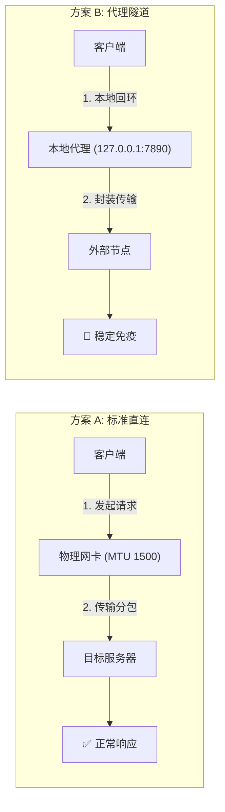
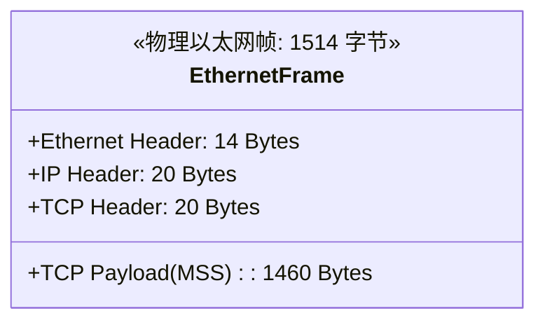
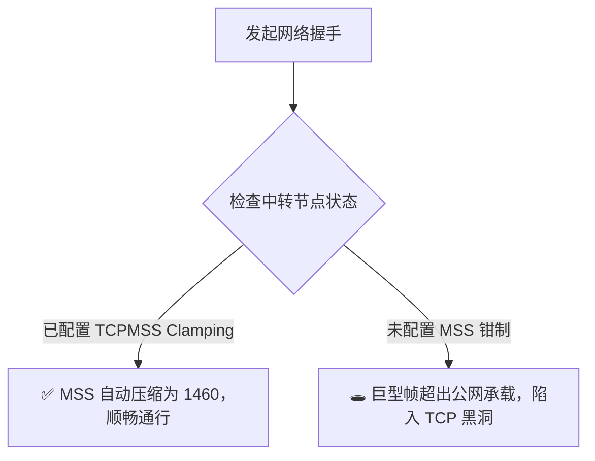

# 🎨 Mermaid 作图最佳实践与避坑排查指南

> ⚠️ **自我约束契约（必读）**：
> **每次学习到新的 Mermaid 作图 Bug 解决方案时，都要更新这个 Skill，来约束自己。**
> 在为用户生成任何 Mermaid 图表代码前，必须自检是否符合本指南中的铁律，杜绝低级语法错误与渲染挂死。

---

## 🛑 一、Mermaid 核心高频 Bug 与避坑铁律

### 1. 保留关键字碰撞（致命 Syntax Error）
* **错误现象**：
  `Expecting '+', '-', '()', 'ACTOR', got 'loop'` 或 `Parse error on line X: got 'alt' / 'end'`
* **根本原因**：
  在 `sequenceDiagram`（时序图）中，`loop`, `alt`, `opt`, `par`, `critical`, `break`, `rect`, `end` 是语法控制流的**保留关键字**。
  如果将 Actor 或 Participant 简写命名为上述单词（例如：`participant Loop as 本地回环`），词法分析器（Lexer）会将 `Dev->>Loop:` 误认为是循环控制块的开始，导致整个图表解析彻底崩溃。
* **避坑铁律**：
  - **严禁使用单个英语控制流单词作为别名**；
  - 参与者别名一律采用明确语义的复合词或加前缀/后缀：例如用 `Loopback` 代替 `Loop`，用 `Branch_Alt` 代替 `Alt`，用 `End_Point` 代替 `End`。

---

### 2. 特殊字符与中文括号切词陷阱（全量双引号包裹铁律）
* **错误现象**：
  `Parse error: Expecting 'SEMI', 'NEWLINE', 'EOF', got ...` 或节点文本被截断、比较符引起标签错乱。
* **根本原因**：
  - 中文全角中括号 `【】`、圆括号 `（）`、英文半角中括号 `[]`、英文圆括号 `()`；
  - 比较运算符 `<`、`>`、`<=`、`>=`（会被误判为连线箭头操作符）；
  - 冒号 `:`、分号 `;`、竖线 `|`、斜杠 `/`、引号等；
  未加双引号包裹时，Mermaid 的分词器会将其当作图元结构标记解析。
* **避坑铁律**：
  - **所有节点的显示文本（Label）、连线文本、子图标题，必须无条件使用英文双引号 `""` 包裹！**
  - **正确示范**：
    ```mermaid
    flowchart LR
        A["【渠道 A】普通直连 (MSS <= 1460B)"] -->|"Step 1: 握手请求"| B["远端服务器"]
    ```
  - **错误示范**：
    ```mermaid
    flowchart LR
        A[【渠道 A】普通直连 (MSS <= 1460B)] -->|Step 1: 握手| B[远端服务器]  %% 危险！
    ```

---

### 3. 渲染位图超限（Size Limit Exceeded: 512KB）与图型选型
* **错误现象**：
  `Generated PNG exceeds size limit of 512000 bytes` 或在某些 Markdown 客户端、Notion、GitHub 中加载白屏、渲染极度缓慢。
* **根本原因**：
  多分支、多阶段的时序图（`sequenceDiagram`）如果横向泳道超过 5 个、纵向交互超过 15 步，渲染引擎计算布局树时会生成极大的画布，导致位图体积超过 512KB 硬限制。
* **图型选型与重构策略**：
  1. **多方案对比 / 网络分流 / 架构拓扑**：
     - **首选 `flowchart LR` 或 `flowchart TD` + `subgraph`**！
     - 流程图对于分支并列对比有天然的排版优势，渲染紧凑、文件小巧、容错率高。
  2. **端到端协议交互 / 极简时序握手**：
     - 当且仅当专注于 2~3 个参与者的微观时序交互时使用 `sequenceDiagram`，并尽量精简步骤。
  3. **数据结构 / 报文头封装 / 契约模型**：
     - 首选 `classDiagram`，直观呈现字段大小与字节分配。

---

### 4. 子图（subgraph）与方向定义规范
* **规范原则**：
  - 子图 ID 必须为英文字母和数字，禁止包含空格与特殊字符；
  - 子图显示名称必须使用双引号包裹：`subgraph Sub1["渠道 A: 物理直连"]`；
  - 每个子图内部若需要独立排版，可显式声明 `direction TB` 或 `direction LR`。

---

## 🛠️ 二、Mermaid 诊断与验证工作流（Workflow）

当编写或遇到 Mermaid 图表异常时，严格按照以下步骤诊断：

```mermaid
flowchart TD
    Step1["1. 检查语法基本要素"] --> Check1{"是否有保留关键字碰撞?<br/>(Loop, Alt, Opt, End等)"}
    Check1 -->|是| Fix1["重命名别名为复合词 (如 Loopback)"]
    Check1 -->|否| Check2{"所有节点文本是否都加了双引号 \"\"?"}
    
    Check2 -->|否| Fix2["全量加上英文双引号包裹"]
    Check2 -->|是| Check3{"是否包含未转义比较符 < > 或括号?"}
    
    Check3 -->|是| Fix3["放入双引号或使用转义"]
    Check3 -->|否| Step2["2. 使用 MCP 工具真实渲染验证"]
    
    Fix1 --> Step2
    Fix2 --> Step2
    Fix3 --> Step2

    Step2 --> ToolCall["调用 validate_and_render_mermaid_diagram"]
    ToolCall --> RenderResult{"渲染是否成功?"}
    RenderResult -->|是| Success["✅ 验证通过，安全落盘输出"]
    RenderResult -->|报错超限 512KB| Refactor["重构为 flowchart LR + subgraph 布局"]
    RenderResult -->|报错语法错误| Learn["调用 get_mermaid_syntax_document 查阅规范并修正"]
    Refactor --> Step2
    Learn --> Step2
```

---

## 📋 三、通用模版参考库

### 1. 方案对比 / 多渠道流程图（推荐模版）


### 2. 报文协议 / 帧结构图（推荐模版）


### 3. 分支判断决策图（推荐模版）


---

## 🔄 四、技能演进记录（更新日志）

| 日期 | 学习来源 / 场景 | 新增约束与解决方案 |
| :--- | :--- | :--- |
| **2026-10-05** | Clash TUN 2.4 时序图渲染崩溃排查 | 1. 发现并固化 `sequenceDiagram` 中 `Loop` 等关键字碰撞导致 `got 'loop'` 崩溃问题；<br/>2. 规范中文方括号 `【】` 及比较符 `<>` 必须全量用双引号包裹；<br/>3. 记录 512KB 渲染超限问题，确立“多链路对比优先选用 `flowchart LR + subgraph`”的选型铁律。 |
